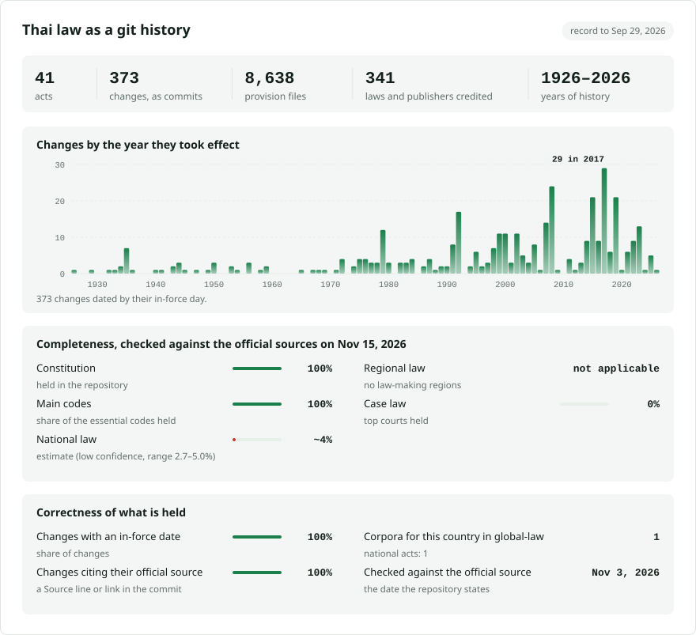

# Thailand: law history in git

[ไทย](README.md) · **English**

<picture>
<source media="(prefers-color-scheme: dark)" srcset="data/effort-dark.svg">

</picture>

The law of Thailand as a git history: one file per section, one commit per version on the day it took effect, and the instrument that made each change as the commit's author. `git blame` names the instrument behind every paragraph; `git log` lists every change to a section; picking a date gives the text in force that day.

Part of [lexifina/global-law](https://github.com/lexifina/global-law), one git history for every country's law: this is Thailand's national law, which global-law reads at `thailand/national/acts/`.

**What is in it now:** 41 laws as the Office of the Council of State (OCS) consolidates them: the Constitution of B.E. 2560 (2017), six codes (among them the Civil and Commercial Code and the Criminal Code), 33 Acts and one Royal Ordinance, with 373 texts in force from 1926 to 2026. [`REPRODUCE.md`](REPRODUCE.md) lists every act with its number of texts and its first and last days; [`laws.csv`](laws.csv) lists every instrument with its Gazette reference and dates.

Each act is a folder named in English, one file per section (มาตรา): `labour-protection/s-118.md` is มาตรา ๑๑๘ of the พระราชบัญญัติคุ้มครองแรงงาน พ.ศ. ๒๕๔๑, the Labour Protection Act B.E. 2541 (1998); `labour-protection/s-011-1.md` is มาตรา ๑๑/๑ and `criminal-code/s-277-bis.md` มาตรา ๒๗๗ ทวิ. `title.md` holds the title and preamble, `end/` what the OCS prints after the text (the note of reasons, each amending instrument's transitional provisions), and each act's `README.md` lists its sections and how often each changed.

The text is in Thai, with Thai digits, as the OCS publishes it. An English translation is not part of this record.

## Questions as git commands

| Question | Command |
| --- | --- |
| Every change to section 118 (severance pay) of the Labour Protection Act | `git log -p --word-diff -- labour-protection/s-118.md` |
| Which instrument wrote each line of section 118? | `git blame labour-protection/s-118.md` |
| Every version of the Labour Protection Act, with the day each took effect | `git log --format="%h %(trailers:key=In-force,valueonly,separator=) %an" -- labour-protection ':!labour-protection/README.md'` |
| Section 118 as in force on 1 January 2019 | `python tools/thai.py 2019-01-01 labour-protection 118` |

**Outside git**, we also host this record publicly, for free:

- **[Ask Claude about Thai law](https://global-law.lexifina.com/v1/try_claude?country=thailand)**: opens Claude with a first question ready.
- **[Ask ChatGPT](https://global-law.lexifina.com/v1/try_chatgpt?country=thailand)**: the same question in ChatGPT.
- **[Search Thai law on our site](https://lexifina.com/law?country=thailand&q=%E0%B8%A7%E0%B8%B1%E0%B8%99%E0%B8%AB%E0%B8%A2%E0%B8%B8%E0%B8%94%E0%B8%9E%E0%B8%B1%E0%B8%81%E0%B8%9C%E0%B9%88%E0%B8%AD%E0%B8%99%E0%B8%9B%E0%B8%A3%E0%B8%B0%E0%B8%88%E0%B8%B3%E0%B8%9B%E0%B8%B5)**: a search for "วันหยุดพักผ่อนประจำปี" (annual leave), with each provision's text and its versions, no account needed.
- **[Developer REST API](https://global-law.lexifina.com/v1/search_law?query=%E0%B8%A7%E0%B8%B1%E0%B8%99%E0%B8%AB%E0%B8%A2%E0%B8%B8%E0%B8%94%E0%B8%9E%E0%B8%B1%E0%B8%81%E0%B8%9C%E0%B9%88%E0%B8%AD%E0%B8%99%E0%B8%9B%E0%B8%A3%E0%B8%B0%E0%B8%88%E0%B8%B3%E0%B8%9B%E0%B8%B5&jurisdiction=thailand)**: the same search as JSON, with no key. See the [documentation here](https://lexifina.com/api/global-law).

Both assistants read the record through the free Global law connector (MCP, `https://global-law.lexifina.com/mcp`); the first time, the chat gives you the link that adds it. Ask in Thai or in English.

**Host it yourself easily.** All it takes is git and Python, and the tools run on your machine:

```sh
git clone --depth 1 https://github.com/lexifina/global-law && cd global-law
python3 tools/countries.py add thailand/national/acts
python3 tools/law.py show 2026-01-01 thailand/national/acts/labour-protection/s-118.md
```

Opened in Claude Code, Cursor, VS Code or Codex, the clone also starts a local MCP server with the same tools ([MCP.md](https://github.com/lexifina/global-law/blob/main/MCP.md)).

## Dates

Each commit is dated at noon, Asia/Bangkok, on the day the version took effect, and carries it in its `In-force:` trailer:

- the day the OCS gives each text: an act takes effect on the day its section 2 sets, often the day after its publication in the Royal Gazette (ราชกิจจานุเบกษา); `Promulgated:` and `Gazette:` give that publication as the OCS prints it;
- where the OCS consolidated an amendment after one that took effect later, each one's changes are applied in the order they took effect, and the commit says so (`Text: rebuilt ...`);
- until B.E. 2483 the Thai year began on 1 April, and the OCS puts 1 January to 31 March of those years a year early; here they are in the right year (the Civil and Commercial Code takes effect on 1926-01-01);
- git cannot store dates before 1970, so the 40 earlier commits are dated 1 January 1970, with the real day in `In-force:`. Ask for a date with `tools/thai.py`, not `git log --before`.

Each act's first text is credited to the act itself, and each change to the instrument that made it (an amending act, royal decree or NCPO order), with an address from its Gazette reference that cannot exist (`rg-136-43a-21@ratchakitcha.invalid`). The OCS names the amending act for 263 of the 332 changes; 64 are credited to the instrument that day's consolidation newly reprints, and 5 with neither to the OCS (`Evidence:` trailer). The committer is always Lexifina.

## How it is checked

- `tools/build/check_repo.py` reads every text in force back from git on its day and compares it with the OCS text, file by file and, independently of the parser, letter by letter against the HTML the OCS serves.
- Each growth is appended a second time from the same head into a scratch clone and must give the same hashes; [`REPRODUCE.md`](REPRODUCE.md) records the last check and rebuild.
- `tools/build/test_repo.py` checks that blame, the dated tool and the commands above work.
- History is append-only: acts added after the first build come after it, each in in-force order, and no published commit is rewritten.
- [vulnerabilities/](vulnerabilities/README.en.md): possible drafting mistakes in this law, found by global-law's detectors and checked by hand. Not run yet.

## What it does not show

- **The official text.** The OCS's consolidations are an aid; the official text is the one published in the Royal Gazette, which is not read here.
- **Changes that leave the words alone**: ministerial regulations made under an act, court rulings, commencement conditions.
- **Earlier constitutions.** The Constitution starts with its text of 2017.
- **The Firearms Act.** Its folder holds only the OCS's notice that the Act of B.E. 2477 (1934) is repealed, pointing to the Royal Gazette; the Act of B.E. 2490 (1947) is not here.
- **Most Thai law.** Other Acts, royal decrees, ministerial regulations, local ordinances, court decisions and bills are not here.

## Sources

| Source | Kind | Past versions | Notes |
| --- | --- | --- | --- |
| [Office of the Council of State: law database](https://searchlaw.ocs.go.th/council-of-state/) (สำนักงานคณะกรรมการกฤษฎีกา) | Consolidated texts of Thai laws | yes, the act as enacted, each amending act and a consolidated text for each day the act changed | Not the official text; Gazette references as its footnotes print them |

## Licence

See [`LICENSE`](LICENSE). The texts of Thai laws are not copyright works: section 7 of the Copyright Act B.E. 2537 (1994) excludes the Constitution, laws and other official texts of the state. The OCS publishes no terms of use for its database. The arrangement, commit messages, tables, documentation and tools are by Lexifina.

No AI model wrote or edited legal text, and none runs when the history is built; the scripts were written by an AI model (see [`REPRODUCE.md`](REPRODUCE.md)).

## Visualisations

- [visualisations/](visualisations/README.en.md): charts drawn from this repository. Not drawn yet.

## More

From [lexifina/global-law](https://github.com/lexifina/global-law):

- [FEATURES.md](https://github.com/lexifina/global-law/blob/main/FEATURES.md): every feature, and what every corpus must support (`git blame`, `law.py`, the MCP tools)
- [FAQ.md](https://github.com/lexifina/global-law/blob/main/FAQ.md): questions and answers · [CONTRIBUTING.md](https://github.com/lexifina/global-law/blob/main/CONTRIBUTING.md): proposing changes · [MCP.md](https://github.com/lexifina/global-law/blob/main/MCP.md): the MCP server · [REPRODUCE.md](https://github.com/lexifina/global-law/blob/main/REPRODUCE.md): how it was built · [CHANGELOG.md](https://github.com/lexifina/global-law/blob/main/CHANGELOG.md)
- [FRESHNESS.md](https://github.com/lexifina/global-law/blob/main/FRESHNESS.md): how current each corpus is · [Monitoring](https://github.com/lexifina/global-law/tree/main/monitoring): whether updates are running · [WATCHING.md](https://github.com/lexifina/global-law/blob/main/WATCHING.md): how each official source is watched for changes
- [performance/](https://github.com/lexifina/global-law/tree/main/performance): how fast the tools are, measured
- [visualisations/](https://github.com/lexifina/global-law/tree/main/visualisations): charts and bridges across the world's law
- [Vulnerabilities](https://github.com/lexifina/global-law/tree/main/vulnerabilities): mistakes in legislation as published
