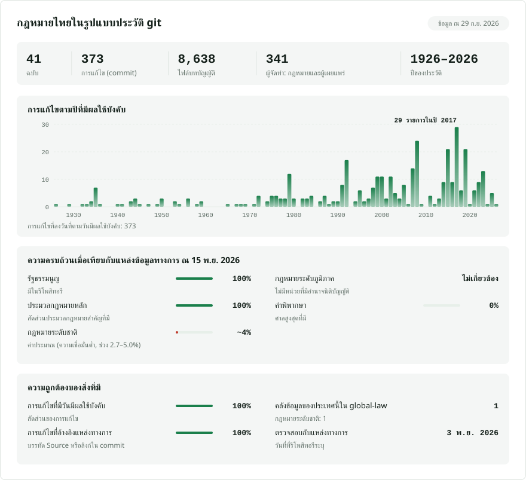

# ประเทศไทย: ประวัติกฎหมายใน git

**ไทย** · [English](README.en.md)

<picture>
<source media="(prefers-color-scheme: dark)" srcset="data/th/effort-dark.svg">

</picture>

กฎหมายของประเทศไทยในรูปของประวัติ git: หนึ่งไฟล์ต่อหนึ่งมาตรา หนึ่งคอมมิตต่อหนึ่งฉบับในวันที่ฉบับนั้นมีผลใช้บังคับ และกฎหมายที่ทำให้เกิดการเปลี่ยนแปลงแต่ละครั้งเป็นผู้เขียน (author) ของคอมมิต `git blame` ระบุกฎหมายที่อยู่เบื้องหลังทุกวรรค `git log` แสดงการเปลี่ยนแปลงทั้งหมดของมาตราหนึ่ง และการเลือกวันที่จะได้ตัวบทที่ใช้บังคับในวันนั้น

เป็นส่วนหนึ่งของ [lexifina/global-law](https://github.com/lexifina/global-law) ซึ่งเป็นประวัติ git เดียวของกฎหมายทุกประเทศ: รีโพสิทอรีนี้คือกฎหมายระดับชาติของประเทศไทย ซึ่ง global-law อ่านที่ `thailand/national/acts/`

**สิ่งที่มีอยู่ในขณะนี้:** กฎหมาย 41 ฉบับตามที่สำนักงานคณะกรรมการกฤษฎีกา (สคก.) รวบรวมไว้ ได้แก่ รัฐธรรมนูญ พ.ศ. 2560 (ค.ศ. 2017) ประมวลกฎหมาย 6 ฉบับ (ซึ่งรวมถึงประมวลกฎหมายแพ่งและพาณิชย์และประมวลกฎหมายอาญา) พระราชบัญญัติ 33 ฉบับ และพระราชกำหนด 1 ฉบับ โดยมีตัวบทที่ใช้บังคับ 373 ฉบับ ตั้งแต่ ค.ศ. 1926 ถึง ค.ศ. 2026 [`REPRODUCE.md`](REPRODUCE.md) แสดงกฎหมายทุกฉบับพร้อมจำนวนตัวบทและวันแรกและวันสุดท้าย [`laws.csv`](laws.csv) แสดงกฎหมายทุกฉบับที่ทำให้เกิดการเปลี่ยนแปลงพร้อมการอ้างอิงราชกิจจานุเบกษาและวันที่

กฎหมายแต่ละฉบับเป็นโฟลเดอร์ที่ตั้งชื่อเป็นภาษาอังกฤษ หนึ่งไฟล์ต่อหนึ่งมาตรา: `labour-protection/s-118.md` คือ มาตรา ๑๑๘ แห่งพระราชบัญญัติคุ้มครองแรงงาน พ.ศ. ๒๕๔๑ `labour-protection/s-011-1.md` คือ มาตรา ๑๑/๑ และ `criminal-code/s-277-bis.md` คือ มาตรา ๒๗๗ ทวิ `title.md` เก็บชื่อและคำปรารภ `end/` เก็บสิ่งที่ สคก. พิมพ์ไว้ต่อท้ายตัวบท (หมายเหตุเหตุผลในการประกาศใช้ บทเฉพาะกาลของกฎหมายที่แก้ไขแต่ละฉบับ) และ `README.md` ของกฎหมายแต่ละฉบับแสดงมาตราต่าง ๆ และจำนวนครั้งที่แต่ละมาตราถูกแก้ไข

ตัวบทเป็นภาษาไทยและใช้เลขไทยตามที่ สคก. เผยแพร่ บันทึกนี้ไม่มีคำแปลภาษาอังกฤษ

## คำถามในรูปคำสั่ง git

| คำถาม | คำสั่ง |
| --- | --- |
| การเปลี่ยนแปลงทั้งหมดของมาตรา 118 (ค่าชดเชย) แห่งพระราชบัญญัติคุ้มครองแรงงาน | `git log -p --word-diff -- labour-protection/s-118.md` |
| กฎหมายฉบับใดเขียนแต่ละบรรทัดของมาตรา 118 | `git blame labour-protection/s-118.md` |
| ทุกฉบับของพระราชบัญญัติคุ้มครองแรงงาน พร้อมวันที่แต่ละฉบับมีผลใช้บังคับ | `git log --format="%h %(trailers:key=In-force,valueonly,separator=) %an" -- labour-protection ':!labour-protection/README.md'` |
| มาตรา 118 ตามที่ใช้บังคับในวันที่ 1 มกราคม 2019 | `python tools/thai.py 2019-01-01 labour-protection 118` |

**นอก git** เรายังเผยแพร่บันทึกนี้ต่อสาธารณะโดยไม่มีค่าใช้จ่าย:

- **[ถาม Claude เกี่ยวกับกฎหมายไทย](https://global-law.lexifina.com/v1/try_claude?country=thailand)**: เปิด Claude พร้อมคำถามแรกที่เตรียมไว้
- **[ถาม ChatGPT](https://global-law.lexifina.com/v1/try_chatgpt?country=thailand)**: คำถามเดียวกันใน ChatGPT
- **[ค้นหากฎหมายไทยบนเว็บไซต์ของเรา](https://lexifina.com/law?country=thailand&q=%E0%B8%A7%E0%B8%B1%E0%B8%99%E0%B8%AB%E0%B8%A2%E0%B8%B8%E0%B8%94%E0%B8%9E%E0%B8%B1%E0%B8%81%E0%B8%9C%E0%B9%88%E0%B8%AD%E0%B8%99%E0%B8%9B%E0%B8%A3%E0%B8%B0%E0%B8%88%E0%B8%B3%E0%B8%9B%E0%B8%B5)**: ผลการค้นหา "วันหยุดพักผ่อนประจำปี" พร้อมตัวบทของแต่ละบทบัญญัติและฉบับต่าง ๆ ของบทบัญญัตินั้น ไม่ต้องมีบัญชีผู้ใช้
- **[REST API สำหรับนักพัฒนา](https://global-law.lexifina.com/v1/search_law?query=%E0%B8%A7%E0%B8%B1%E0%B8%99%E0%B8%AB%E0%B8%A2%E0%B8%B8%E0%B8%94%E0%B8%9E%E0%B8%B1%E0%B8%81%E0%B8%9C%E0%B9%88%E0%B8%AD%E0%B8%99%E0%B8%9B%E0%B8%A3%E0%B8%B0%E0%B8%88%E0%B8%B3%E0%B8%9B%E0%B8%B5&jurisdiction=thailand)**: การค้นหาเดียวกันในรูป JSON โดยไม่ต้องใช้คีย์ ดู[เอกสารประกอบได้ที่นี่](https://lexifina.com/api/global-law)

ผู้ช่วยทั้งสองอ่านบันทึกนี้ผ่านตัวเชื่อมต่อ Global law ที่ไม่มีค่าใช้จ่าย (MCP, `https://global-law.lexifina.com/mcp`) ในการใช้ครั้งแรก แชตจะให้ลิงก์สำหรับเพิ่มตัวเชื่อมต่อนั้น ถามเป็นภาษาไทยหรือภาษาอังกฤษก็ได้

**โฮสต์เองได้ง่าย** ใช้เพียง git และ Python และเครื่องมือทำงานบนเครื่องของคุณเอง:

```sh
git clone --depth 1 https://github.com/lexifina/global-law && cd global-law
python3 tools/countries.py add thailand/national/acts
python3 tools/law.py show 2026-01-01 thailand/national/acts/labour-protection/s-118.md
```

เมื่อเปิดใน Claude Code, Cursor, VS Code หรือ Codex โคลนนี้จะเริ่มเซิร์ฟเวอร์ MCP ภายในเครื่องที่มีเครื่องมือชุดเดียวกันด้วย ([MCP.md](https://github.com/lexifina/global-law/blob/main/MCP.md))

## วันที่

คอมมิตแต่ละรายการลงวันที่เวลาเที่ยงวัน (Asia/Bangkok) ของวันที่ฉบับนั้นมีผลใช้บังคับ และบันทึกวันนั้นไว้ในเทรลเลอร์ `In-force:`:

- วันที่ สคก. ระบุสำหรับตัวบทแต่ละฉบับ: พระราชบัญญัติมีผลใช้บังคับในวันที่มาตรา 2 ของพระราชบัญญัตินั้นกำหนด ซึ่งมักเป็นวันถัดจากวันประกาศในราชกิจจานุเบกษา `Promulgated:` และ `Gazette:` ระบุการประกาศนั้นตามที่ สคก. พิมพ์ไว้
- ในกรณีที่ สคก. รวบรวมการแก้ไขฉบับหนึ่งไว้หลังจากฉบับที่มีผลใช้บังคับภายหลัง การเปลี่ยนแปลงของแต่ละฉบับจะนำมาใช้ตามลำดับวันที่มีผลใช้บังคับ และคอมมิตจะระบุไว้ (`Text: rebuilt ...`)
- จนถึง พ.ศ. 2483 ปีของไทยเริ่มต้นในวันที่ 1 เมษายน และ สคก. นำวันที่ 1 มกราคมถึง 31 มีนาคมของปีเหล่านั้นไปไว้เร็วกว่าความจริงหนึ่งปี ในที่นี้วันที่เหล่านั้นอยู่ในปีที่ถูกต้อง (ประมวลกฎหมายแพ่งและพาณิชย์มีผลใช้บังคับในวันที่ 1926-01-01)
- git ไม่สามารถเก็บวันที่ก่อน ค.ศ. 1970 ได้ ดังนั้นคอมมิต 40 รายการที่เก่ากว่านั้นจึงลงวันที่ 1 มกราคม 1970 โดยมีวันที่จริงอยู่ใน `In-force:` การสอบถามตามวันที่ให้ใช้ `tools/thai.py` ไม่ใช่ `git log --before`

ตัวบทฉบับแรกของกฎหมายแต่ละฉบับให้เครดิตแก่กฎหมายฉบับนั้นเอง และการเปลี่ยนแปลงแต่ละครั้งให้เครดิตแก่กฎหมายที่ทำให้เกิดการเปลี่ยนแปลงนั้น (พระราชบัญญัติแก้ไขเพิ่มเติม พระราชกฤษฎีกา หรือคำสั่ง คสช.) โดยใช้ที่อยู่ที่สร้างจากการอ้างอิงราชกิจจานุเบกษาซึ่งไม่อาจมีอยู่จริง (`rg-136-43a-21@ratchakitcha.invalid`) สคก. ระบุกฎหมายที่แก้ไขสำหรับการเปลี่ยนแปลง 263 รายการจาก 332 รายการ 64 รายการให้เครดิตแก่กฎหมายที่การรวบรวมของวันนั้นพิมพ์ขึ้นใหม่ และ 5 รายการที่ไม่มีทั้งสองอย่างให้เครดิตแก่ สคก. (เทรลเลอร์ `Evidence:`) ผู้คอมมิต (committer) คือ Lexifina เสมอ

## วิธีการตรวจสอบ

- `tools/build/check_repo.py` อ่านตัวบทที่ใช้บังคับทุกฉบับกลับจาก git ในวันของตัวบทนั้น และเปรียบเทียบกับตัวบทของ สคก. ทีละไฟล์ และเปรียบเทียบทีละตัวอักษรกับ HTML ที่ สคก. ให้บริการ โดยไม่อาศัยตัวแยกวิเคราะห์ (parser)
- การเพิ่มข้อมูลแต่ละครั้งจะถูกต่อท้ายซ้ำอีกครั้งจาก head เดียวกันลงในโคลนสำหรับทดลอง และต้องได้แฮชเดียวกัน [`REPRODUCE.md`](REPRODUCE.md) บันทึกการตรวจสอบและการสร้างใหม่ครั้งล่าสุด
- `tools/build/test_repo.py` ตรวจสอบว่า blame เครื่องมือตามวันที่ และคำสั่งข้างต้นทำงานได้
- ประวัติมีแต่การต่อท้ายเท่านั้น: กฎหมายที่เพิ่มหลังการสร้างครั้งแรกจะอยู่ต่อจากนั้น แต่ละฉบับเรียงตามลำดับวันที่มีผลใช้บังคับ และไม่มีการเขียนคอมมิตที่เผยแพร่แล้วใหม่
- [vulnerabilities/](vulnerabilities/): ข้อผิดพลาดในการร่างที่อาจมีในกฎหมายนี้ ซึ่งตัวตรวจจับของ global-law ค้นพบและตรวจด้วยมือ ยังไม่ได้รัน

## สิ่งที่ไม่ได้แสดง

- **ตัวบทที่เป็นทางการ** ฉบับรวบรวมของ สคก. เป็นเพียงเครื่องช่วย ตัวบทที่เป็นทางการคือตัวบทที่ประกาศในราชกิจจานุเบกษา ซึ่งไม่ได้อ่านในที่นี้
- **การเปลี่ยนแปลงที่ไม่ได้แก้ถ้อยคำ**: กฎกระทรวงที่ออกตามพระราชบัญญัติ คำวินิจฉัยของศาล เงื่อนไขการเริ่มใช้บังคับ
- **รัฐธรรมนูญฉบับก่อน ๆ** รัฐธรรมนูญเริ่มต้นที่ตัวบท พ.ศ. 2560 (ค.ศ. 2017)
- **พระราชบัญญัติอาวุธปืน** โฟลเดอร์ของพระราชบัญญัตินี้มีเพียงประกาศของ สคก. ว่าพระราชบัญญัติ พ.ศ. 2477 (ค.ศ. 1934) ถูกยกเลิกแล้ว โดยอ้างถึงราชกิจจานุเบกษา พระราชบัญญัติ พ.ศ. 2490 (ค.ศ. 1947) ไม่มีอยู่ในที่นี้
- **กฎหมายไทยส่วนใหญ่** พระราชบัญญัติอื่น ๆ พระราชกฤษฎีกา กฎกระทรวง ข้อบัญญัติท้องถิ่น คำพิพากษาของศาล และร่างกฎหมาย ไม่มีอยู่ในที่นี้

## แหล่งที่มา

| แหล่งที่มา | ประเภท | ฉบับในอดีต | หมายเหตุ |
| --- | --- | --- | --- |
| [สำนักงานคณะกรรมการกฤษฎีกา: ฐานข้อมูลกฎหมาย](https://searchlaw.ocs.go.th/council-of-state/) (สำนักงานคณะกรรมการกฤษฎีกา) | ตัวบทกฎหมายไทยฉบับรวบรวม | มี ได้แก่ กฎหมายตามที่ตราขึ้น กฎหมายที่แก้ไขแต่ละฉบับ และตัวบทฉบับรวบรวมสำหรับทุกวันที่กฎหมายนั้นเปลี่ยนแปลง | ไม่ใช่ตัวบทที่เป็นทางการ การอ้างอิงราชกิจจานุเบกษาเป็นไปตามที่เชิงอรรถของฐานข้อมูลพิมพ์ไว้ |

## สัญญาอนุญาต

ดู [`LICENSE`](LICENSE) ตัวบทกฎหมายไทยไม่ใช่งานอันมีลิขสิทธิ์: มาตรา 7 แห่งพระราชบัญญัติลิขสิทธิ์ พ.ศ. 2537 (ค.ศ. 1994) ยกเว้นรัฐธรรมนูญ กฎหมาย และข้อความทางราชการอื่น ๆ ของรัฐ สคก. ไม่ได้ประกาศข้อกำหนดการใช้งานฐานข้อมูลของตน การจัดเรียง ข้อความคอมมิต ตาราง เอกสารประกอบ และเครื่องมือ จัดทำโดย Lexifina

ไม่มีโมเดล AI ใดเขียนหรือแก้ไขตัวบทกฎหมาย และไม่มีโมเดลใดทำงานขณะสร้างประวัติ สคริปต์เขียนขึ้นโดยโมเดล AI (ดู [`REPRODUCE.md`](REPRODUCE.md))

ข้อความนี้แปลจากฉบับภาษาอังกฤษ ([README.en.md](README.en.md)) หากมีความแตกต่าง ให้ถือฉบับภาษาอังกฤษเป็นหลัก

## การแสดงผลด้วยภาพ

- [visualisations/](visualisations/): แผนภูมิที่สร้างจากคลังนี้ ยังไม่ได้สร้าง

## ข้อมูลเพิ่มเติม

จากรีโพสิทอรี [lexifina/global-law](https://github.com/lexifina/global-law) (หน้าภาษาอังกฤษ):

- [FEATURES.md](https://github.com/lexifina/global-law/blob/main/FEATURES.md): ความสามารถทั้งหมด และสิ่งที่คลังข้อมูลแต่ละแห่งต้องรองรับ (`git blame`, `law.py`, เครื่องมือ MCP)
- [FAQ.md](https://github.com/lexifina/global-law/blob/main/FAQ.md): คำถามที่พบบ่อย · [CONTRIBUTING.md](https://github.com/lexifina/global-law/blob/main/CONTRIBUTING.md): การเสนอแก้ไข · [MCP.md](https://github.com/lexifina/global-law/blob/main/MCP.md): เซิร์ฟเวอร์ MCP · [REPRODUCE.md](https://github.com/lexifina/global-law/blob/main/REPRODUCE.md): วิธีที่สร้างขึ้น · [CHANGELOG.md](https://github.com/lexifina/global-law/blob/main/CHANGELOG.md)
- [FRESHNESS.md](https://github.com/lexifina/global-law/blob/main/FRESHNESS.md): ความเป็นปัจจุบันของคลังข้อมูลแต่ละแห่ง · [การติดตาม](https://github.com/lexifina/global-law/tree/main/monitoring): การอัปเดตทำงานอยู่หรือไม่ · [WATCHING.md](https://github.com/lexifina/global-law/blob/main/WATCHING.md): วิธีเฝ้าดูการเปลี่ยนแปลงของแหล่งทางการแต่ละแห่ง
- [performance/](https://github.com/lexifina/global-law/tree/main/performance): ความเร็วของเครื่องมือตามที่วัดได้
- [visualisations/](https://github.com/lexifina/global-law/tree/main/visualisations): แผนภูมิและความเชื่อมโยงข้ามกฎหมายทั่วโลก
- [ช่องโหว่](https://github.com/lexifina/global-law/tree/main/vulnerabilities): ข้อผิดพลาดในกฎหมายตามที่ประกาศใช้
